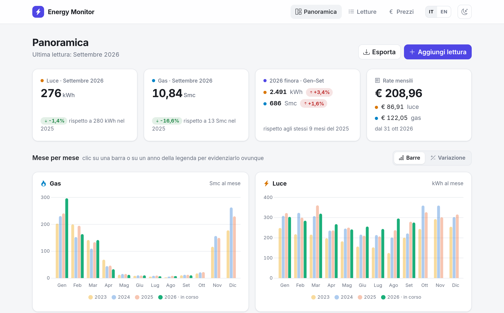
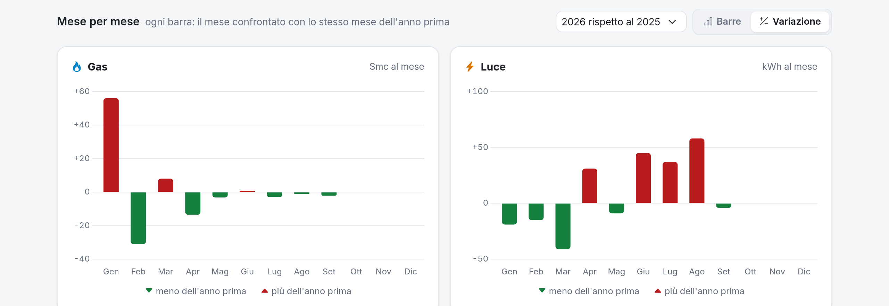
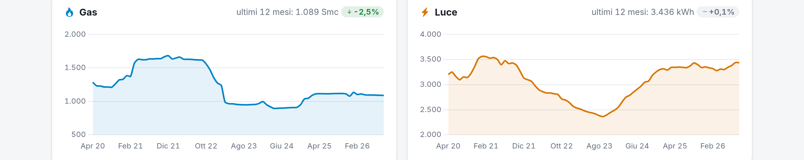
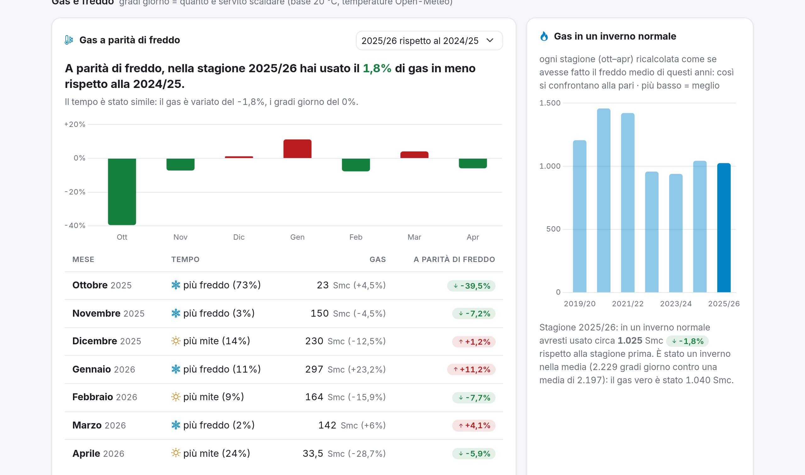
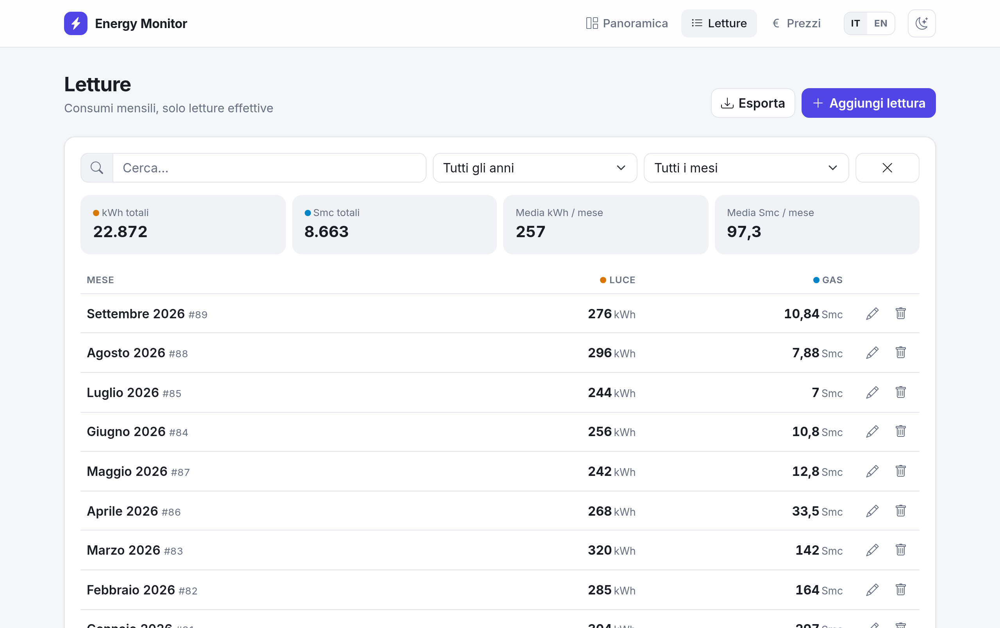
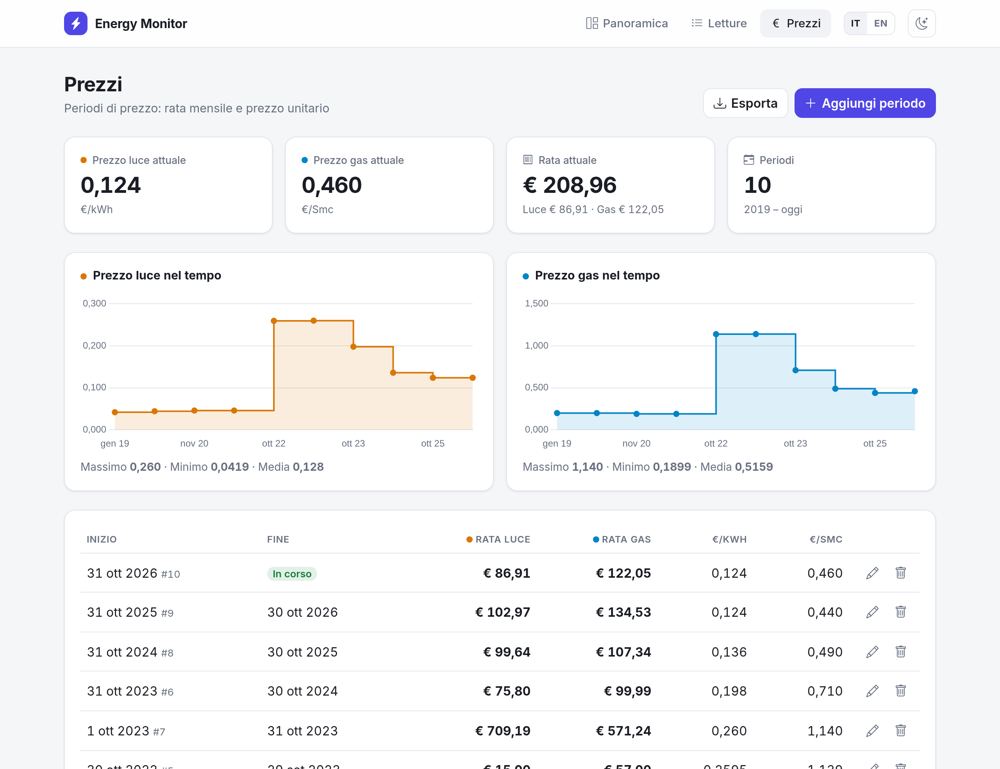
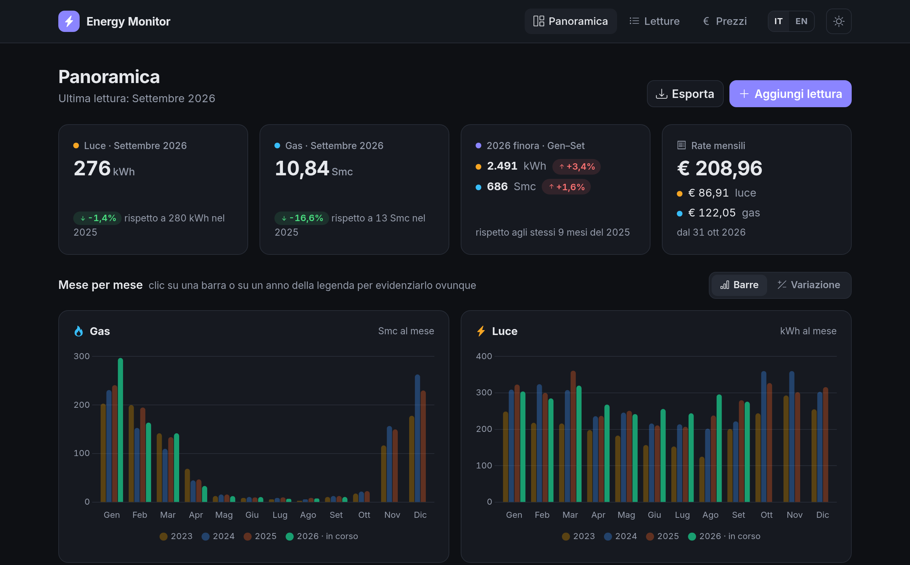
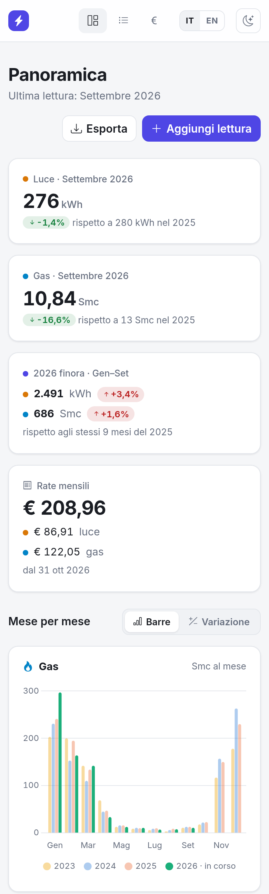

# Simple energy consumption analyzer

Luce e gas di casa in una pagina: letture mensili, confronti anno su anno, prezzi e rate,
e il gas confrontato con quanto ha fatto freddo davvero.

*A small self-hosted Flask app to track monthly electricity (kWh) and gas (Smc) readings, prices and
installments. Italian by default, English with `?lang=en`.*



## Cosa fa

- **Panoramica**: ultimo mese confrontato con lo stesso mese dell'anno prima, l'anno in corso confrontato
  con gli stessi mesi del precedente, le rate attuali.
- **Mese per mese**: gas e luce per anno, ogni anno col suo colore e l'anno in corso in evidenza; passa
  sopra o clicca un anno (anche in legenda) per evidenziarlo in tutti i grafici.
- **Variazione**: per ogni mese quanto hai consumato in più (rosso) o in meno (verde) rispetto allo stesso
  mese dell'anno prima.
- **Andamento a 12 mesi**: ogni punto è il consumo dei 12 mesi precedenti, quindi senza l'effetto delle
  stagioni: mostra se negli anni stai davvero consumando di più o di meno.
- **Gas e freddo** (facoltativo): i gradi giorno della tua zona dall'archivio storico di
  [Open-Meteo](https://open-meteo.com/) (gratuito, senza chiave). Il gas di ogni mese viene diviso per
  quanto ha fatto freddo e confrontato con la stagione prima, così un inverno più rigido non sembra uno
  spreco; e ogni stagione (ott–apr) viene ricalcolata come se avesse fatto il freddo medio.
- **Prezzi e rate**: periodi di prezzo con rata mensile e prezzo unitario, prezzo e rata mese per mese.
- Tema chiaro e scuro (segue il sistema, si cambia in alto), italiano/inglese, si usa anche dal telefono.

| Variazione sull'anno prima | Andamento a 12 mesi |
|---|---|
|  |  |



| Letture | Prezzi |
|---|---|
|  |  |

| Tema scuro | Telefono |
|---|---|
|  |  |

## Avvio

Serve Docker con Compose.

```sh
cp .env.example .env      # poi metti password e SECRET_KEY veri
make up                   # costruisce e avvia app + PostgreSQL (migrazioni automatiche)
```

L'app risponde su `http://localhost:8000` (porta in `APP_PORT`). `make help` elenca gli altri comandi.

### Gradi giorno (facoltativo)

Metti nel `.env` le coordinate di casa; due decimali (circa 1 km) bastano:

```sh
WEATHER_LAT=<latitudine, per esempio 45.46>
WEATHER_LON=<longitudine, per esempio 9.19>
```

Senza coordinate la sezione «Gas e freddo» non compare. Le temperature giornaliere arrivano dall'archivio
Open-Meteo e restano in memoria 12 ore; se la rete non risponde la pagina funziona lo stesso.
I gradi giorno sono quelli della norma italiana: somma di (20 °C − temperatura media del giorno) quando
è positiva. Il `.env` non va su git (`make check-public` lo controlla su tutta la storia).

## Dati

Due tabelle:

- `consumption`: anno, mese, kWh, Smc. **Solo letture effettive**: un mese stimato in bolletta aspetta la
  bolletta che lo ricalcola, altrimenti i confronti mentono.
- `cost`: periodi di prezzo (inizio, fine vuota = in corso), rata mensile luce e gas in €, prezzo
  unitario €/kWh ed €/Smc.

API JSON: `GET/POST /consumption`, `GET/PUT/DELETE /consumption/<id>`, idem per `/cost`;
esportazione Excel da `/consumption/export` e `/cost/export`.

## Sviluppo

```sh
make test           # unittest nel container: numeri della panoramica, gradi giorno, traduzioni
make check-public   # prima di pubblicare: niente .env, chiavi, dump, host privati o coordinate
```

- I numeri della panoramica si calcolano in `app/chart/dashboard.py` da righe semplici, senza database:
  i test partono da valori noti (bollette vere) e controllano l'uscita attesa.
- Le scritte stanno in `app/i18n.py` (italiano, inglese); un test verifica che ogni chiave usata nelle
  pagine esista in entrambe le lingue.
- Grafici con [Chart.js](https://www.chartjs.org/) 4.4.1, stile in `app/static/css/app.css`.

## Da fare

- [ ] Aggiungere la colonna `mc` (acqua) accanto a `kwh` e `smc` per tracciare anche il consumo idrico:
  modello `Consumption` (+ migrazione Alembic), API ed export, form, lista e grafici; le righe storiche
  restano senza valore.
